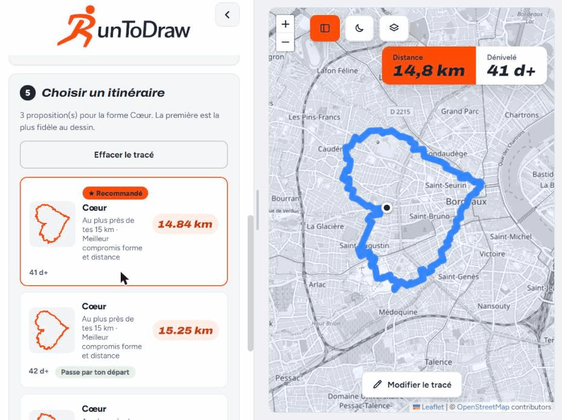
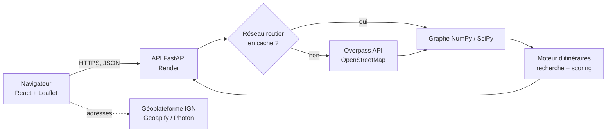

# RunToDraw

**Dessiner avec ses jambes.** RunToDraw génère des parcours de course à pied ou de marche qui reproduisent une forme, un texte ou un dessin libre sur la carte, en suivant uniquement les rues et chemins qui existent vraiment. Le résultat s'exporte en GPX (Strava, montres GPS) ou en KML (Google My Maps).

**Démo en ligne : [runtodraw.vercel.app](https://runtodraw.vercel.app)**
(le serveur est sur une offre gratuite : la première requête peut prendre une minute si le serveur dormait)

<!-- Ajouter ici une capture ou un GIF de démonstration, par exemple :
 -->

Projet individuel (P2I) réalisé à l'ENSC (Bordeaux INP), conçu et développé de bout en bout : algorithmique de graphes, API, interface cartographique, déploiement.

---

## Ce que fait l'application

- **Point de départ** : position actuelle, recherche d'adresse (France et monde) ou clic sur la carte ; l'adresse choisie est affichée.
- **14 formes** : carré, cercle, cœur, étoile, infini, triangle, losange, croix, flèche, maison, éclair, croissant, goutte, tour Eiffel.
- **Texte** : lettres majuscules A à Z et chiffres 0 à 9, dessinées uniquement par leurs traits. Trois propositions : mot entier, lettres séparées (un GPX par lettre, ou un ZIP) et lettres reliées par le plus court chemin.
- **Dessin libre** : l'utilisateur trace une forme d'un seul trait (souris, doigt ou stylet, avec un mode plein écran sur smartphone).
- **Plusieurs propositions** pour une distance cible : la plus proche de la distance demandée, et un meilleur compromis entre fidélité du dessin et distance, par deux méthodes comparables (projection directe et translation optimale).
- **Édition du tracé** à la manière de Strava : déplacer, ajouter ou supprimer un point, annuler et rétablir, le tracé est recalculé sur les vraies routes.
- **Dénivelé** de chaque proposition (altitudes Open-Meteo, lissées), **lien de partage** qui recalcule le même parcours, **exemples** en un clic et écran d'accueil invité.
- **Attente soignée** : chronomètre en direct avec durée estimée (affinée par les mesures passées), notification de fin de calcul, état des serveurs OpenStreetMap affiché avant de lancer.
- **Application installable** sur l'écran d'accueil du téléphone (manifeste et service worker).
- **Interface responsive** : panneau latéral sur ordinateur, tiroir qui se glisse vers le bas sur smartphone ; thème jour et nuit (suit le réglage de l'appareil) ; fond de carte neutre pour faire ressortir le tracé.

---

## Architecture



| Couche | Technologies |
|---|---|
| Frontend | React 19, Vite, Leaflet / React-Leaflet, CSS (jeu de variables jour / nuit) |
| Backend | Python 3.12, FastAPI, Uvicorn, Pydantic v2, NumPy, SciPy |
| Données | OpenStreetMap via Overpass (plusieurs miroirs interrogés en parallèle) |
| Déploiement | Vercel (frontend), Render avec Docker (backend), GitHub Actions |
| Tests | pytest, plus de 110 tests (géométrie, graphe, recherche, édition, API, protections) |

### Organisation du dépôt

```
backend/runtodraw/   moteur et API (graphe, formes, recherche, scoring, texte, édition, cache)
backend/tests/       tests automatisés
backend/tools/       outils de mesure (Overpass, export du graphe)
frontend/src/        interface (composants, hooks, API cliente, styles)
docs/                guide de déploiement
```

---

## Les algorithmes

**Du réseau routier au graphe.** Les routes OpenStreetMap sont converties en graphe pondéré (sommets : carrefours, arêtes : tronçons avec leur longueur). Les autoroutes, accès privés, parkings et voies interdites aux piétons sont écartés ; les trottoirs et passages piétons sont conservés pour ne perdre aucun cheminement. Le graphe est stocké au format CSR (SciPy) avec un index spatial (arbre k-d) pour retrouver instantanément le carrefour le plus proche d'un point.

**Transformer un dessin en parcours.** Une forme est une courbe normalisée. On génère des candidats (taille, rotation, position), puis chaque point du dessin est accroché au graphe et les points sont reliés par des plus courts chemins (A*). Deux méthodes servent de base de comparaison :

- la **projection directe** accroche chaque point de la forme au carrefour le plus proche ;
- la **translation optimale** cherche le décalage du dessin qui améliore la correspondance avec le réseau.

**Évaluer un tracé.** Un score combine la ressemblance avec le dessin (distance de Chamfer symétrique renforcée par un centile élevé, pour qu'un détail manqué coûte cher, calculée avec des arbres k-d), l'écart à la distance demandée et la fluidité (pénalité de virages). La taille est calibrée pour tomber sur la distance cible. Les formes ont des règles d'orientation (une maison reste droite, une flèche peut pointer partout) pour rester reconnaissables.

**Dessin libre.** Le trait est nettoyé côté serveur (simplification de Douglas-Peucker, fermeture automatique si le trait revient près de son départ, plafond de points), puis normalisé comme n'importe quelle forme.

**Texte.** Chaque lettre est un tracé de traits simples (sans remplissage). Chaque lettre est dimensionnée selon la longueur de son tracé pour que les hauteurs restent égales. Pour les lettres reliées, une programmation dynamique choisit le sens de parcours de chaque lettre afin de minimiser la longueur des liaisons.

**Édition du tracé.** Chaque morceau garde ses « points d'ancrage ». Déplacer un point ne recalcule que les un ou deux tronçons voisins, avec un appel léger et sans état, ce qui rend l'édition quasi instantanée. Les lettres reliées sont recalculées à partir des lettres modifiées.

---

## Choix d'ingénierie

- **Cache côté serveur** du graphe routier (par zone), avec un verrou par zone : deux demandes simultanées ne téléchargent qu'une fois. Le graphe ne transite plus par le navigateur.
- **Résilience face à Overpass** : quatre à cinq miroirs publics sont interrogés en cascade avec départ échelonné (le premier qui répond l'emporte), et un nouvel essai automatique à distance inchangée en cas d'échec.
- **Protections de l'API** : limites de requêtes par IP, calculs simultanés plafonnés, validation stricte des entrées (Pydantic), erreurs lisibles sans détail interne, CORS configurable.
- **Sans dépendance inutile** : export ZIP des lettres écrit à la main, mini-moteur de dessin en SVG, état géré par des hooks React.
- **Accessibilité** : navigation au clavier, focus visible, cibles tactiles d'au moins 44 px, mouvements réduits respectés.

---

## Installation en local

Prérequis : Python 3.10+, Node.js 18+, Git.

```bash
git clone https://github.com/Remi-1508/RunToDraw.git
cd RunToDraw
```

**Backend** (premier terminal)

```bash
cd backend
python -m pip install -r requirements.txt
python -m uvicorn runtodraw.api:app --reload --port 8000
```

**Frontend** (second terminal)

```bash
cd frontend
npm install
npm run dev
```

L'application est alors sur http://localhost:5173. Les tests du moteur :

```bash
cd backend
python -m pip install -r requirements-dev.txt
python -m pytest
```

### Configuration

Le backend lit ses réglages dans des variables d'environnement (liste commentée dans `backend/.env.example`) ; aucune n'est nécessaire en local. En production, il faut au minimum `RUNTODRAW_ALLOWED_ORIGINS` (adresse du site). Le frontend utilise `VITE_ROUTE_API_URL` (adresse de l'API) et, facultativement, `VITE_GEOAPIFY_KEY` pour la recherche d'adresses hors de France (voir `frontend/.env.example`).

## Déploiement

Frontend sur Vercel, backend sur Render (image Docker), déploiement automatique à chaque push sur `main`. Le guide pas à pas est dans [docs/deploiement.md](docs/deploiement.md). Un workflow GitHub Actions (`.github/workflows/keep-alive.yml`) appelle `/health` toutes les 10 minutes pour éviter l'endormissement du serveur gratuit.

## API

| Méthode | Route | Rôle |
|---|---|---|
| GET | `/health` | état du serveur et distance maximale autorisée |
| GET | `/api/status` | état des miroirs Overpass (mis en cache 45 s) |
| POST | `/api/graph/fetch` | charge (ou lit en cache) le réseau routier de la zone |
| POST | `/api/routes/plan` | calcule les propositions d'itinéraires |
| POST | `/api/routes/edit` | recalcule les tronçons voisins d'un point déplacé, ajouté ou supprimé |
| POST | `/api/routes/link` | relie des lettres (éventuellement modifiées) en un seul parcours |

## Conseils d'utilisation

- **Distance** : à partir de 8 à 10 km, les formes sont nettement plus réussies, car le réseau disponible est plus riche. Les petites distances donnent des formes plus approximatives.
- **Texte** : 1 à 3 lettres donnent les meilleurs résultats.
- **Premier calcul** : le téléchargement du réseau routier peut prendre une à deux minutes selon la zone et la disponibilité d'Overpass ; il reste ensuite en mémoire.

## Limites connues et pistes

- Les serveurs Overpass publics sont gratuits mais variables : d'où les miroirs en cascade et un nouvel essai automatique (la distance demandée n'est jamais modifiée).
- L'offre gratuite de Render limite la distance à 25 km (mémoire de 512 Mo) et endort le serveur sans trafic.
- À venir : comptes utilisateurs (adresses et parcours favoris, historique, statistiques).

## Auteur

**Rémi Monier**, élève ingénieur à l'ENSC (Bordeaux INP).
[LinkedIn](https://www.linkedin.com/in/remi-monier-ensc)
